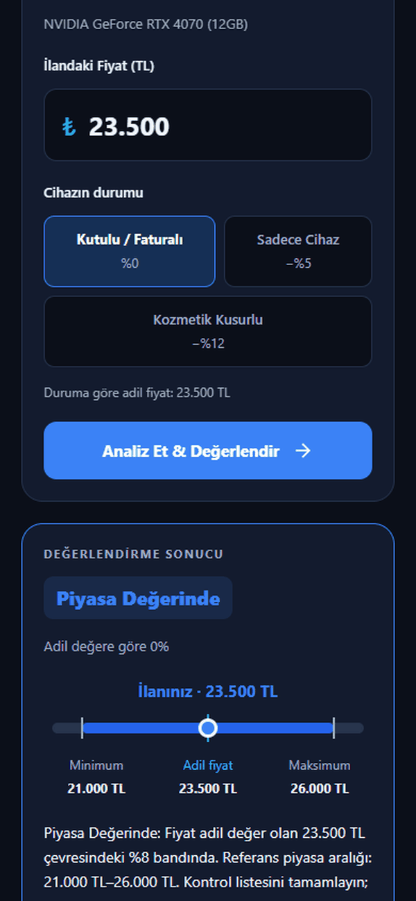
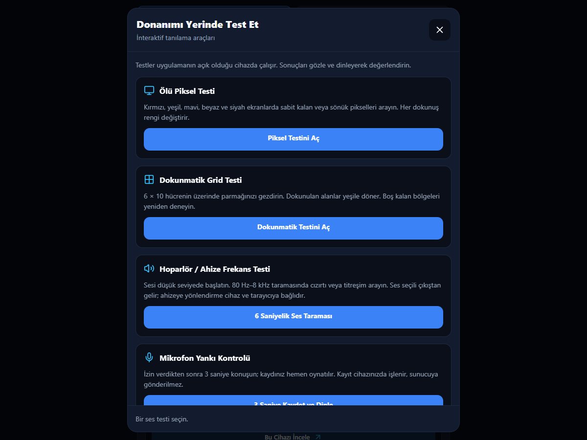
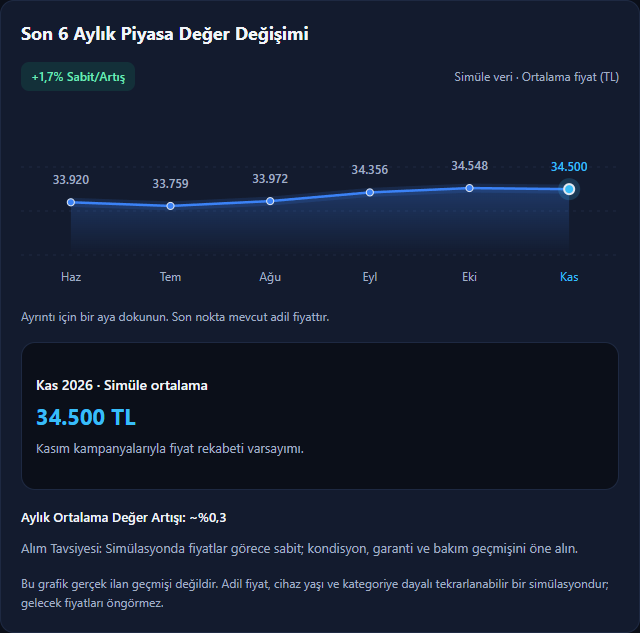
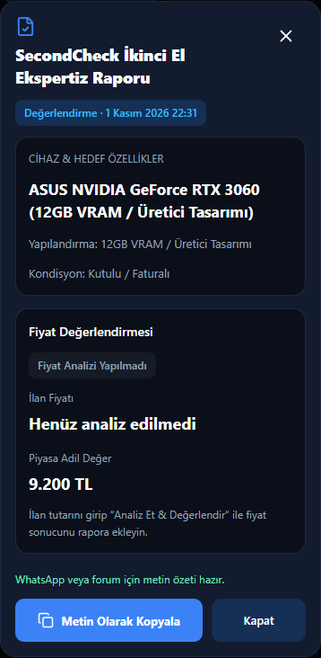
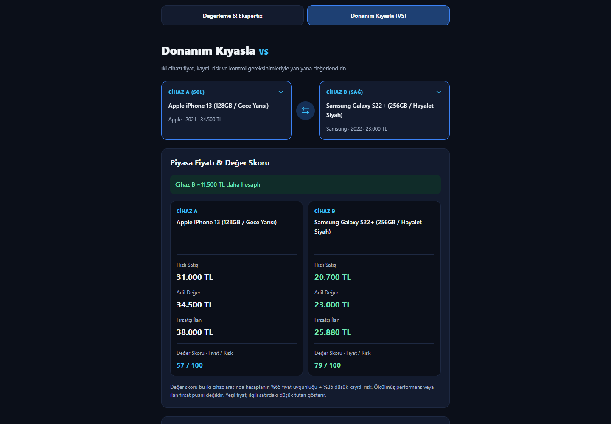

<div align="center">
  <h1>SecondCheck</h1>
  <p><strong>İkinci el donanımda güvenli kararın ikinci kontrolü.</strong></p>
  <p>Donanımını incele, fiyatını değerlendir, güvenle karar ver.</p>
  <p>
    
    
    
    
    
  </p>
</div>

<div align="center">
  
  <p><i>SecondCheck: İkinci el donanım ekspertiz, test ve değerleme akışı</i></p>
</div>

SecondCheck, ikinci el elektronik alışverişlerinde donanım kontrolünü, fiyat değerlendirmesini ve cihaz karşılaştırmasını tek bir akışta birleştiren React Native / Expo tabanlı web ve mobil platformudur. Ürünü bulun, kontrol listesini tamamlayın ve ekspertiz özetinizi paylaşın.

## Ekran Görüntüleri & Modüller

<table>
  <tr>
    <td align="center" width="50%">
      <h3>Donanım Kontrol &amp; Teşhis</h3>
      
      <p>Ekran, dokunmatik, hoparlör ve mikrofon testleriyle yerinde kontrol.</p>
    </td>
    <td align="center" width="50%">
      <h3>Fiyat Analizi &amp; Trend</h3>
      
      <p>Kondisyona göre değerleme ve altı aylık simüle fiyat değişimi.</p>
    </td>
  </tr>
  <tr>
    <td align="center" width="50%">
      <h3>Doğrulama &amp; Ekspertiz Raporu</h3>
      
      <p>Tamamlanan kontrolleri, riskleri ve değerleme sonucunu bir araya getiren özet.</p>
    </td>
    <td align="center" width="50%">
      <h3>Parça Karşılaştırma Modülü</h3>
      
      <p>İki cihazın fiyat aralığını, risklerini ve kontrol gereksinimlerini karşılaştırın.</p>
    </td>
  </tr>
</table>

## ✨ Temel Özellikler

| Özellik | Deneyim |
| --- | --- |
| 📱 **PWA Desteği** | Mobil uyumlu web arayüzü, ana ekrana ekleme için simge ve bağımsız pencere görünümü ayarları. |
| 🌙 **Koyu Tema** | `#0b0f19` zemin üzerinde okunaklı kartlar; açık tema seçeneği. |
| ✅ **Test Checklist'i** | Cihaza özel fiziksel kontrol adımları, ilerleme takibi ve yerinde donanım testleri. |
| 💸 **Piyasa Değerleme** | Yerel örnek katalog ve kondisyon katsayılarıyla fiyat değerlendirmesi; simüle trend görünümü. |
| ⚖️ **Donanım Karşılaştırma** | İki cihazı veya aynı kategorideki kayıtlı ilanları yan yana inceleme. |
| 🧾 **Ekspertiz Özeti** | Kontrol sonuçlarını ve riskleri bir raporda toplama, metin olarak kopyalama. |
| 🔎 **İlan Ayrıştırma & Kayıt** | İlan metninden ürün ve fiyat bilgilerini çıkarma, ilanları cihazda saklama. |

**Veri modeli:** Mevcut sürüm yerel ve deterministik bir örnek katalog kullanır. Fiyatlar canlı ilanlardan çekilmez; trend grafiği simülasyondur. Sahibinden veya Letgo ile resmî entegrasyon ya da ortaklık bulunmaz.

## 🛠️ Teknoloji Yığını

| Teknoloji | Kullanım |
| --- | --- |
| **React Native + Expo** | Web, Android ve iOS için ortak uygulama altyapısı. |
| **TypeScript** | Tip güvenliği ve sürdürülebilir geliştirme. |
| **React Context API** | Tema ve kayıtlı ilanların durum yönetimi. |
| **AsyncStorage / localStorage** | Cihaz üzerinde kalıcı ilan kaydı. |
| **React Native SVG + Lucide** | Trend grafikleri ve arayüz ikonları. |
| **Vercel** | Statik Expo web çıktısını yayınlama hedefi; SPA yönlendirme yapılandırması. |

## 👨‍💻 Geliştirici & İletişim

**Berkay Yılmaz** · Kurucu & Geliştirici

- **GitHub:** [@BerkayYLMZ53](https://github.com/BerkayYLMZ53)
- **LinkedIn:** [Berkay Yılmaz](https://www.linkedin.com/in/berkay-yilmaz-253ab0292/)
- **Web:** [berkayylmz.com.tr](https://berkayylmz.com.tr)

## 🚀 Kurulum Adımları

Node.js ve npm kurulu olmalıdır. Proje dizininde:

```bash
npm install
npx expo start
```

Expo terminalinde **w** ile web arayüzünü açabilirsiniz. Android veya iOS için uyumlu bir cihaz ya da emülatör kullanın; iOS Simulator için macOS ve Xcode gerekir.

```bash
# Doğrudan web arayüzünü başlatın
npm run web

# Yayına hazır web çıktısını üretin
npm run build:web
```

Web derlemesi `dist/` dizinine yazılır. Depodaki `pnpm-lock.yaml` ile kilitli kurulum tercih ediliyorsa `pnpm install --frozen-lockfile` ve ardından `pnpm start` kullanılabilir.

## 📚 Teknik Belgeler

<details>
<summary><strong>Kullanım akışı, veri modeli, testler ve yayınlama rehberi</strong></summary>

## 🎯 Temel Kullanım Akışı

1. **Ürünü bulun.** Marka/model araması veya kategori filtrelerini kullanın. Alternatif olarak ilan metnini üstteki karta yapıştırıp **Ayrıştır & Analiz Et** düğmesine dokunun.
2. **Fiyat ve kondisyonu doğrulayın.** İlan fiyatını girin; kutulu/faturalı, sadece cihaz veya kozmetik kusurlu durumlarından uygun olanı seçin.
3. **Analizi inceleyin.** Fiyat değerlendirmesi, simüle trend, kronik sorunlar ve alternatif modelleri birlikte değerlendirin.
4. **Yerinde kontrol yapın.** Kontrol listesini tamamlayın; test kitini ürünün kendisinde veya test edilecek ekran/ses donanımına bağlı cihazda çalıştırın.
5. **Kaydedin veya paylaşın.** İlanı bir notla listenize ekleyin ya da kontrol sonuçlarından metin raporu oluşturun.
6. **Kıyaslayın.** Kaydedilenler penceresinde aynı kategoriden iki ilan seçerek istenen fiyatları ve donanım bilgilerini karşılaştırın.

Kargo ile alımlarda, fiziksel kontrol listesinin üstündeki güvenlik rehberini de açabilirsiniz. Güvenlik kutularını işaretlemek platformda ödeme veya ürün onayı vermez.

### İlan metni örnekleri

```text
MSI RTX 3070 Ti 8GB fiyat: 14.500 TL kutu yok fatura var
iPhone 13 256GB 34.500₺ pil sağlığı %79 ekran değişmiş
m1 air 8GB 256GB 22000 kutu yok
Ryzen 5600 3.800 TL
```

Ayrıştırıcı yerel katalog üzerinde çalışır; ilan URL’sini ziyaret etmez. Eksik kapasite veya marka bilgileri nedeniyle en yakın varyant seçilebilir. Birden fazla farklı fiyat bulunduğunda tutarı tahmin etmek yerine manuel giriş ister. Pil ve parça değişimi uyarıları ayrıca gösterilir; bunlar otomatik bir onarım maliyetine dönüştürülmez.

## 📊 Değerleme ve Veri Modeli

Her ürün; benzersiz kimlik, kategori, marka/model, çıkış yılı, minimum/adil/maksimum piyasa referansları, kronik sorunlar, kontrol listesi ve alternatifler içerir.

| Kondisyon | Adil değer için kullanılan katsayı |
| --- | --- |
| Kutulu / Faturalı | `%100` |
| Sadece Cihaz | `%95` |
| Kozmetik Kusurlu | `%88` |

Değerlendirme, kondisyonla uyarlanmış adil değeri temel alır:

- **Fırsat:** Adil değerin `%8`den fazla altında.
- **Piyasa Değerinde:** Adil değerin `±%8` bandında.
- **Pahalı / Pazarlık Yapılmalı:** Adil değerin `%8`den fazla üzerinde.

Ana ekrandaki kronik sorun skoru `0–100`, VS modundaki donanım risk endeksi ise `0–10` aralığındadır. Bunlar farklı ölçeklerdeki tarama puanlarıdır; ölçülmüş arıza olasılığı veya performans testi sonucu değildir.

Katalog erişimi `data/mockProducts.ts` üzerinden sağlanır:

```typescript
import {
  PRODUCTS_DATABASE,
  getProductById,
  searchProducts,
} from './data/mockProducts';

const matches = searchProducts('RTX 3060', 'gpu', 20);
const product = matches[0] ? getProductById(matches[0].id) : undefined;
const totalVariants = PRODUCTS_DATABASE.length;
```

Ürün verileri genişletilirken `marketPriceMin < fairPrice < marketPriceMax` sıralaması korunmalıdır. Ürün kimlikleri kayıtlı ilanların `productId` alanında kullanıldığından, kimlik değişikliklerinin mevcut kayıtlara etkisi değerlendirilmelidir.

## 📁 Proje Yapısı

```text
SecondCheck/
├── App.tsx                         # Tema, kayıtlı ilanlar ve ekran geçişleri
├── index.ts                        # Expo giriş noktası
├── app.json                        # Uygulama, ses izinleri ve Android klavye ayarı
├── screens/
│   ├── HomeScreen.tsx              # Arama, değerleme ve ekspertiz akışı
│   └── CompareScreen.tsx           # Donanım / kayıtlı ilan kıyaslaması
├── components/
│   ├── ListingParserCard.tsx
│   ├── PriceTrendSection.tsx
│   ├── ChronicIssuesSection.tsx
│   ├── InspectionChecklist.tsx
│   ├── AlternativesSection.tsx
│   ├── HardwareDiagnosticsModal.tsx
│   ├── ExpertiseReportModal.tsx
│   ├── SavedListingsModal.tsx
│   ├── SecurityGuideModal.tsx
│   └── ...                         # Ortak stiller, seçiciler ve tema araçları
├── context/
│   ├── ThemeContext.tsx
│   └── SavedListingsContext.tsx
├── data/mockProducts.ts            # Üretilebilir örnek katalog
├── types/                          # Ürün ve kayıtlı ilan tipleri
├── utils/                          # Değerleme, ayrıştırma, trend ve platform yardımcıları
├── assets/diagnostic-sweep.wav      # Mobil ses taraması
├── styles/web.css                  # Web görünümü ve viewport desteği
├── tests/                          # Ayrıştırıcı ve kayıtlı ilan testleri
├── pnpm-lock.yaml
├── vercel.json                     # SPA yönlendirme kuralı
└── .gitignore
```

## ✅ Kod Kalitesi ve Testler

```bash
# Strict TypeScript kontrolü
npm run typecheck

# Sıfır uyarı politikasıyla lint
npm run lint

# İlan ayrıştırıcı testleri
npm run test:listing-parser

# Kayıtlı ilan veri modeli ve değerleme testleri
npm run test:saved-listings
```

Testler model eşleşmelerini, Türkçe fiyat biçimlerini, kusur ifadelerini, katalog başlıklarının doğru varyanta çözülmesini, kayıt doğrulamasını, benzersiz kimlikleri ve kondisyon katsayılarını kapsar. Test çalıştırıcısı, projede bulunan TypeScript paketini kullanır.

Arayüz değişikliklerinde 360 px telefon görünümünü, tablet/masaüstü düzenini, her iki temayı ve klavye açıkken form/modalleri ayrıca kontrol edin. Native ses, mikrofon, çentik ve klavye davranışı fiziksel cihazda da doğrulanmalıdır.

## 📦 Production Web Derlemesi

```bash
npm run build:web
```

Bu script `npx expo export --platform web` komutunu çalıştırır ve statik çıktıyı **`dist/`** dizinine üretir. Kaynak değişikliklerinden sonra yeniden derleme gerekir. Expo’nun dağıtım akışı için [resmî web yayınlama rehberine](https://docs.expo.dev/guides/publishing-websites/) bakabilirsiniz.

`dist/` Git’e eklenmez; yerel derlemede veya hosting platformunun build aşamasında üretilir. HTTPS ile yayınlamak, özellikle mikrofon ve pano API’lerinin kullanılabilirliği açısından önemlidir.

### Vercel

GitHub deposunu Vercel’e aktarın ve aşağıdaki ayarları uygulayın:

| Ayar | Değer |
| --- | --- |
| Framework Preset | `Other` — statik Expo çıktısı |
| Root Directory | Proje kökü |
| Build Command | `npm run build:web` |
| Output Directory | `dist` |
| Node.js Version | `24.x` |

Depoda bulunan `vercel.json`, istemci tarafı adresler için `/index.html` fallback kuralını içerir. Build ve output ayarları bu dosyada tanımlı olmadığından Vercel proje ayarlarında ayrıca belirtilmelidir. Platform [derleme ayarlarını](https://vercel.com/docs/builds) ve [Node.js sürüm seçimini](https://vercel.com/docs/functions/runtimes/node-js/node-js-versions) destekler.

### Netlify

Netlify üzerinde de build komutunu **`npm run build:web`**, publish dizinini **`dist`** olarak belirleyin. Bu depoda henüz `netlify.toml` bulunmaz; yapılandırmayı dosyada tutmak isterseniz proje köküne aşağıdaki örneği ekleyebilirsiniz:

```toml
[build]
  command = "npm run build:web"
  publish = "dist"

[build.environment]
  NODE_VERSION = "24"

[[redirects]]
  from = "/*"
  to = "/index.html"
  status = 200
```

Bu kural SPA adreslerini `index.html` üzerinden sunar. Ayrıntılar: [Netlify SPA rewrite rehberi](https://docs.netlify.com/manage/routing/redirects/rewrites-proxies/) ve [build bağımlılıkları / Node.js sürümü](https://docs.netlify.com/build/configure-builds/manage-dependencies/).

Her iki platformda da kurulum için tek bir paket yöneticisi seçin. Mevcut pnpm kilit dosyasını kullanıyorsanız kurulum komutu `pnpm install --frozen-lockfile` olabilir; npm akışı tercih ediliyorsa `npm install` kullanılır. Node.js ve paket yöneticisi sürümlerini yerel ortamla uyumlu tutun.

## 🔐 Yerel Kayıt, İzinler ve Gizlilik

- **Kayıtlı ilanlar:** Web’de bu siteye ait `localStorage` alanında, mobilde AsyncStorage içinde saklanır. Kullanıcı hesabı veya bulut senkronizasyonu bulunmaz.
- **Depolama hatası:** Kalıcı kayıt kullanılamazsa uygulama oturum içi bellekle çalışır ve kullanıcıya durumu bildirir. Bu kayıtlar yenileme veya uygulamanın kapanmasıyla kaybolabilir.
- **İlan ayrıştırma:** Yapıştırılan metin yerel olarak işlenir; bir ilan servisine veya yapay zekâ API’sine gönderilmez.
- **Mikrofon:** Test kullanıcı tarafından başlatılır ve izin ister. Kayıt sunucuya yüklenmez; web’de bellekte, mobilde yerel kayıt dosyası üzerinden işlenir.
- **Ses çıkışı:** Tarama cihazın seçili ses çıkışını kullanır. Ahizeye özel yönlendirme cihaz ve tarayıcıya bağlıdır.
- **Pano:** Rapor kopyalama işlemi kullanıcı eylemiyle başlar. Tarayıcı izin vermezse elle seçilip kopyalanabilecek metin gösterilir.

## 🧩 Sık Karşılaşılan Durumlar

| Durum | Kontrol edilecek nokta |
| --- | --- |
| Mikrofon testi başlamıyor | Mikrofon iznini, cihazın giriş kaynağını ve web’de HTTPS/localhost kullanımını kontrol edin. |
| Kopyalama çalışmıyor | Pano iznini kontrol edin veya rapordaki seçilebilir metni elle kopyalayın. |
| Yenilemede kayıtlar kayboluyor | Gizli oturum, engellenmiş depolama, dolu alan veya farklı site adresi kullanımı yerel kaydı etkileyebilir. Uygulamadaki depolama mesajını inceleyin. |
| İlan yanlış varyanta eşleşiyor | Marka, tam model ve kapasite bilgisini ekleyin; otomatik seçilen varyantı doğrulayın. |
| Yayında eski görünüm var | Web çıktısını yeniden üretin ve güncel `dist/` dizininin yayınlandığını kontrol edin. |
| Doğrudan adrese girişte 404 alınıyor | Hosting platformundaki SPA fallback kuralını ve çıktı dizinini kontrol edin. Ekran sekmeleri şu anda URL tabanlı yönlendirme yerine uygulama içi durumla yönetilir. |

## 🤝 Katkıda Bulunma

Değişiklik öncesinde mevcut davranışı inceleyin; küçük ve anlaşılır değişikliklerle ilerleyin. Yeni ürün eklerken kontrol adımlarını uygulanabilir tutun, kronik sorunları kesin arıza iddiası olarak sunmayın ve örnek fiyatların kaynak/tarih varsayımlarını belirtin.

Pull request öncesinde typecheck, lint, ilgili testler ve web derlemesini çalıştırın. Arayüz değişikliklerinde mobil ve masaüstü görünümünü her iki temada kontrol edin. `node_modules/`, `.expo/`, `dist/`, imzalama anahtarları ve sertifikalar gibi `.gitignore` kapsamındaki dosyaları depoya eklemeyin.

## ⚖️ Veri ve Kullanım Notu

Fiyatlar, kronik sorun kayıtları, risk puanları ve üretilen raporlar karar desteği sağlar; cihazın gerçek durumunu, satışın güvenliğini veya gelecekteki fiyatını garanti etmez. Onarım bedelleri servis ve parçaya göre değişebilir. Güvenlik rehberindeki süre ve koşullar için ilgili platformun güncel sipariş ekranı ve resmî kuralları esas alınmalıdır.

**Veriler topluluk bildirimleri ve pazar ortalamaları baz alınarak modellenmiştir. Kesin ekspertiz yerine geçmez.**

## 📄 Lisans

Bu depoda henüz bir `LICENSE` dosyası tanımlanmamıştır. Yeniden kullanım ve dağıtım koşulları için proje sahibinden bilgi alın. Bağımlılıkların lisansları kendi paketlerinde ayrıca yer alır.

</details>
